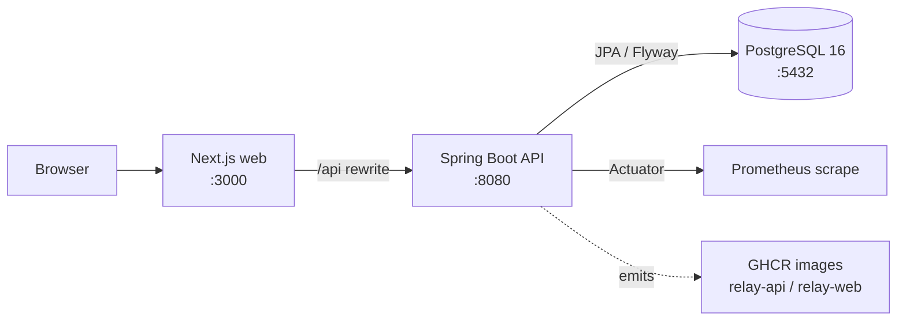

# Relay — Ticket Support System

A full-stack support desk: customers raise tickets, agents are assigned work, and every ticket moves
through a defined lifecycle. Spring Boot API, PostgreSQL, Next.js front end, containerised end to end.

[](https://github.com/wassimhajjijunior/Ticket_Support_System/actions/workflows/ci.yml)
[](https://github.com/wassimhajjijunior/Ticket_Support_System/actions/workflows/cd.yml)

---

## Overview

| | |
|---|---|
| **Domain** | Support ticketing — tickets, projects, comments, assignments, role-based access |
| **Backend** | Spring Boot 3.5 · Java 21 · Spring Security (JWT) · JPA/Hibernate · Flyway |
| **Frontend** | Next.js 15 (App Router) · React 19 · TypeScript · Tailwind v4 · shadcn/ui |
| **Database** | PostgreSQL 16 |
| **Delivery** | Multi-stage Docker images · Docker Compose · GitHub Actions → GHCR · Trivy |
| **Ops** | Actuator health groups, Prometheus metrics endpoint |

### What it does

- **Authentication** — register, log in, stateless JWT. Three roles: `USER`, `AGENT`, `ADMIN`.
- **Tickets** — create, list, filter by status and priority, edit, delete, change status, assign to an agent.
- **Comments** — threaded discussion per ticket with author and timestamp.
- **Dashboard** — live counts by status and priority, a seven-day created/closed trend, recent activity.
- **People** — client directory and agent workload.
- **Profile** — self-service update; role escalation is blocked server-side.

---

## Architecture



Two deployable services plus one database. The front end never hardcodes a backend host: in development
a Next.js rewrite proxies `/api/*`, and in a cluster the ingress owns that path.

---

## Repository layout

```
.
├── app/                     Spring Boot API
│   ├── src/main/java/       controllers, services, repositories, security, config
│   ├── src/main/resources/  application*.properties, Flyway migrations
│   └── Dockerfile           defined in docker/Dockerfile.api
├── web/                     Next.js front end
│   ├── app/                 routes (dashboard, tickets, clients, agents, settings)
│   ├── components/          UI kit, layout, feature views
│   └── lib/                 API client, types, formatters
├── docker/
│   ├── Dockerfile.api       multi-stage, layered JAR, non-root
│   ├── Dockerfile.web       Next standalone output, non-root
│   ├── docker-compose.yml   db + api + web (+ adminer under --profile tools)
│   └── docker-compose.dev.yml  database only, for local development
├── docs/
│   ├── api-contract.md      frozen API contract
│   └── ROADMAP.md           7-day DevOps plan
├── book/                    build write-ups + interview bank
└── .github/workflows/       CI, CD, Dependabot
```

---

## Quick start (Docker)

Requires Docker Desktop. Nothing else — no JDK, no Node, no local database.

```bash
git clone https://github.com/wassimhajjijunior/Ticket_Support_System.git
cd Ticket_Support_System

# optional: copy and edit ports / credentials
cp docker/.env.example docker/.env

docker compose -f docker/docker-compose.yml up -d --build
```

Then open **http://localhost:3000**.

| Service | URL |
|---|---|
| Web | http://localhost:3000 |
| API | http://localhost:8080 |
| API health | http://localhost:8080/actuator/health |
| Metrics | http://localhost:8080/actuator/prometheus |
| Adminer (optional) | `docker compose -f docker/docker-compose.yml --profile tools up -d` → http://localhost:8081 |

Stop everything: `docker compose -f docker/docker-compose.yml down`
Remove the database volume too: `... down -v`

### Demo accounts (development profile only)

| User | Password | Role |
|---|---|---|
| `admin` | `admin123` | ADMIN |
| `agent1` | `agent123` | AGENT |
| `agent2` | `agent123` | AGENT |

> These are created by `DevDataSeeder`, which runs **only** on the `dev` profile. A production
> deployment must set `SPRING_PROFILES_ACTIVE=prod` and provide real credentials — otherwise it ships
> working demo accounts.

---

## Local development (without Docker for the apps)

```bash
# 1. database only
docker compose -f docker/docker-compose.dev.yml up -d

# 2. API  (http://localhost:8080)
cd app && ./mvnw spring-boot:run          # Windows: mvnw.cmd spring-boot:run

# 3. web  (http://localhost:3000)
cd web && npm install && npm run dev
```

The dev server **must** use port 3000: the API's CORS allow-list is `http://localhost:3000`. If you
change the port, update `CORS_ALLOWED_ORIGINS` as well.

> **Windows note:** if your IDE's Java language server writes to `app/target/classes`, run
> `./mvnw clean verify` rather than `verify`. Incremental Maven builds can otherwise reuse stale
> compiler output.

---

## Testing

```bash
cd app
./mvnw -B clean verify      # 4 unit tests + 30 integration tests, H2 profile, no database required
```

```bash
cd web
npx tsc --noEmit --incremental false
npm run lint
npm run build
```

Integration tests cover: authentication and role enforcement, ticket lifecycle, assignment, comments,
statistics aggregation, and the seeding path. The UI currently has no automated test suite — that is a
known gap.

---

## API

Full contract: [`docs/api-contract.md`](docs/api-contract.md).

| Method | Path | Purpose |
|---|---|---|
| POST | `/auth/register` · `/auth/login` | create account · obtain JWT |
| GET | `/user/me` · `/user/all` · `/user/agents` | current user · directory · agents |
| PUT | `/user/{id}` | update profile (owner or admin; role changes admin-only) |
| GET | `/ticket/allTickets` · `/ticket/TicketDetails/{id}` | queue · detail |
| POST | `/ticket/create` | create (auto-assigns the least-busy agent) |
| PUT | `/ticket/TicketUpdate/{id}` | edit |
| PATCH | `/ticket/{id}/status` · `/ticket/{id}/assign` | change status · assign / unassign |
| DELETE | `/ticket/DeleteTicket/{id}` | delete |
| GET/POST | `/ticket/{id}/comments` | read · add comment |
| GET | `/ticket/stats` | dashboard aggregates |
| GET | `/project/allProjects` · POST `/project/create` | projects |

Errors return a consistent body: `{ timestamp, status, error, message, path }`.

---

## Configuration

All configuration is environment-driven; nothing secret is baked into an image.

| Variable | Default | Purpose |
|---|---|---|
| `SERVER_PORT` | `8080` | API port |
| `DB_URL` | `jdbc:postgresql://localhost:55432/ticketsupport` | JDBC URL |
| `DB_USERNAME` / `DB_PASSWORD` | `tickets` / `tickets` | database credentials |
| `JWT_SECRET` | dev-only default | **must be ≥ 32 bytes**; the app refuses to start below that |
| `JWT_EXPIRATION_MS` | `3600000` | token lifetime |
| `CORS_ALLOWED_ORIGINS` | `http://localhost:3000` | allowed browser origin |
| `SPRING_PROFILES_ACTIVE` | `dev` | `dev` runs the seeder; `prod` does not |
| `SEED_ADMIN_PASSWORD` / `SEED_AGENT_PASSWORD` | `admin123` / `agent123` | dev seeding only |

Host database port defaults to **55432** because a native PostgreSQL commonly occupies 5432/5433.
Override with `DB_HOST_PORT`.

---

## Delivery pipeline

```
pull request ──► CI ──► tests + typecheck + lint + build
                   │
merge to main ─────┴──► CD ──► build images ──► push to GHCR ──► Trivy scan
```

- **CI** — path-filtered: backend changes run `mvn verify`, frontend changes run `tsc`, ESLint and
  `next build`. A change in one app never pays for the other's build.
- **CD** — builds both images with BuildKit cache, tags them with the commit SHA plus `latest`, pushes
  to GHCR, then fails the job on fixable `HIGH`/`CRITICAL` vulnerabilities.
- **Dependabot** — weekly updates for Maven, npm, Docker base images and Actions.

Images: `ghcr.io/wassimhajjijunior/relay-api`, `ghcr.io/wassimhajjijunior/relay-web`.

---

## Security notes

- Stateless JWT; `401` and `403` are handled by dedicated JSON handlers.
- Role checks are enforced server-side. Self-promotion via `PUT /user/{id}` is ignored for non-admins;
  `POST /user/admin/createUser` requires `ADMIN`.
- Passwords hashed with BCrypt.
- Containers run as non-root (`1001`).
- Every secret is injected at runtime; `.env` files are gitignored.

Known gaps, stated plainly: no refresh-token rotation, no rate limiting, and the browser token currently
lives in `localStorage` rather than an `HttpOnly` cookie.

### Dependency security backlog

Trivy runs on both images on every merge. It lists all `HIGH`/`CRITICAL` findings and gates on `CRITICAL`.
At the time of writing the backlog is **3 CRITICAL (api) + 1 CRITICAL (web)**, so the gate is set to
**advisory** (`continue-on-error`) until those are resolvable — the step still reports and shows red in
the run, but does not block publishing.

Already remediated: Spring Boot 3.5.3 → **3.5.14**, Tomcat CVE-2026-41293 and CVE-2026-55276,
Next.js 15.3.5 → **15.5.24** (pre-auth RCE CVE-2025-55182 and later).

Two CVEs are suppressed in [`.trivyignore`](.trivyignore) with dated reasons:
`CVE-2026-47884` / `CVE-2026-47890` (spring-webmvc 6.2.x — fixed only in 7.x) and
`CVE-2026-65182` (Tomcat 10.1.58, not yet published to Maven Central).

---

## Documentation

| Document | Contents |
|---|---|
| [`docs/api-contract.md`](docs/api-contract.md) | Frozen API contract |
| [`docs/ROADMAP.md`](docs/ROADMAP.md) | 7-day DevOps plan |
| [`book/chapters/01-docker.md`](book/chapters/01-docker.md) | Annotated Dockerfiles, decisions, failure drills |
| [`book/chapters/02-cicd.md`](book/chapters/02-cicd.md) | Pipeline design and trade-offs |
| [`book/interview/`](book/interview) | Interview bank: Docker, CI/CD, system design |
| [`PROGRESS.md`](PROGRESS.md) | Engineering log with verified results |
| [`SPEC.md`](SPEC.md) | Scope, success criteria, stack decisions |

---

## Roadmap

| Phase | Scope | Status |
|---|---|---|
| Core application | auth, tickets, comments, dashboard, people | ✅ |
| Containerisation | images, Compose, healthchecks, seeding | ✅ |
| CI/CD | tests, scans, GHCR publishing | 🟡 defined — first hosted run pending |
| Infrastructure as code | Terraform: VPC, RDS, EC2 | ⬜ |
| Orchestration | Kubernetes manifests + Helm chart | ⬜ |
| Observability | Prometheus, Grafana, alerts, SLOs | ⬜ |
| GitOps | Argo CD, drift correction, sealed secrets | ⬜ |

---

## License

Personal project — no license declared yet.
