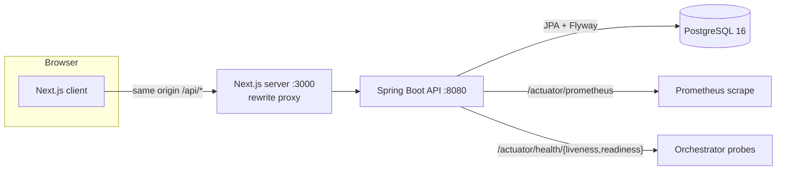
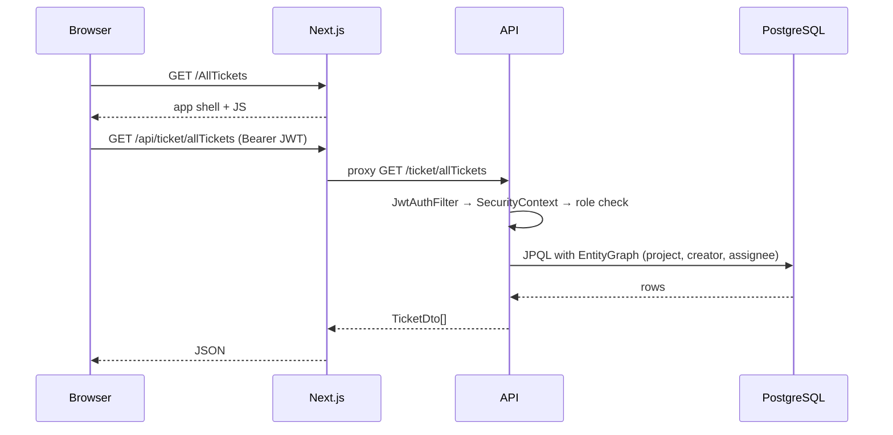
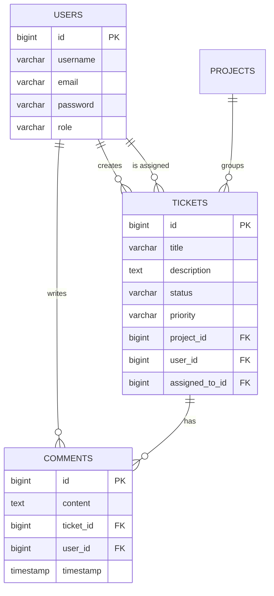
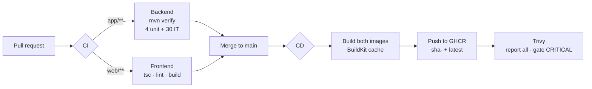

# Relay — Ticket Support System

A production-shaped support desk: customers raise tickets, agents get them assigned, and every ticket
moves through a defined lifecycle. Spring Boot + PostgreSQL + Next.js, containerised end to end, with a
real CI/CD pipeline behind it.

[](https://github.com/wassimhajjijunior/Ticket_Support_System/actions/workflows/ci.yml)
[](https://github.com/wassimhajjijunior/Ticket_Support_System/actions/workflows/cd.yml)

> **Status:** core application and delivery pipeline are complete and verified.
> Infrastructure-as-code, Kubernetes, observability and GitOps are the next phases — see [Roadmap](#roadmap).

---

## Why this exists

Support ticketing is a deceptively good domain to build properly: it needs authentication with distinct
roles, a state machine, ownership and assignment rules, an audit trail, and aggregate reporting. It is
small enough to finish and rich enough that cutting corners shows.

The second goal is the delivery story. The repository is also a working reference for what "shipped"
means: reproducible images, health-gated startup, tests that run in CI, a vulnerability gate, and
versioned artefacts. Everything claimed here is something you can run and check yourself — the commands
are in [Verify it yourself](#verify-it-yourself).

---

## Features

**For requesters**

- Register, sign in, and raise a ticket against a project
- Track status through `PENDING → OPEN → EXECUTED → FINISHED`
- Follow a per-ticket comment thread

**For agents**

- Queue with search, status and priority filters
- Assign or unassign tickets; workload visible per agent
- Update status, edit details, add comments

**For admins**

- Create users and agents, manage projects
- Role enforcement server-side, not in the UI
- Aggregate dashboard: counts by status and priority, seven-day created/closed trend, recent activity

---

## Architecture



Two deployable services and one database. The browser only ever talks to the web origin; `/api/*` is
rewritten server-side. That single decision means the same image works behind Compose, behind an ingress,
or behind a load balancer without rebuilding.

### Request lifecycle



### Data model



---

## Stack

| Layer | Choice | Notes |
|---|---|---|
| API | **Spring Boot 3.5.14**, Java **21** | layered JAR, Actuator health groups |
| Security | Spring Security + **JJWT 0.12.6** | stateless, `ROLE_*` authorities, JSON 401/403 |
| Persistence | **PostgreSQL 16**, Hibernate, **Flyway** | `ddl-auto=validate`; migrations are the source of truth |
| Web | **Next.js 15.5.24** (App Router), React 19, TypeScript strict | server components by default |
| Styling | Tailwind **v4** (CSS-first), shadcn/ui + Radix | design tokens in `app/globals.css` |
| Delivery | Docker (multi-stage), Compose, GitHub Actions, GHCR, Trivy | path-filtered CI, SHA-tagged images |
| Ops | Actuator, Micrometer → `/actuator/prometheus` | probes ready for Kubernetes |

---

## Quick start

Requires Docker Desktop. No JDK, Node or local database needed.

```bash
git clone https://github.com/wassimhajjijunior/Ticket_Support_System.git
cd Ticket_Support_System

cp docker/.env.example docker/.env     # optional: ports and credentials
docker compose -f docker/docker-compose.yml up -d --build
```

Open **http://localhost:3000**.

| Service | URL |
|---|---|
| Web | http://localhost:3000 |
| API | http://localhost:8080 |
| Health | http://localhost:8080/actuator/health |
| Metrics | http://localhost:8080/actuator/prometheus |
| Adminer (optional) | `--profile tools` → http://localhost:8081 |

```bash
docker compose -f docker/docker-compose.yml down      # stop, keep data
docker compose -f docker/docker-compose.yml down -v   # stop and wipe the database
```

### Demo accounts (development profile)

| User | Password | Role |
|---|---|---|
| `admin` | `admin123` | ADMIN |
| `agent1` / `agent2` | `agent123` | AGENT |

> Created by `DevDataSeeder`, which runs **only** on the `dev` profile. A real deployment must set
> `SPRING_PROFILES_ACTIVE=prod` and supply its own credentials, or it will ship working demo accounts.

---

## Local development

```bash
# database only
docker compose -f docker/docker-compose.dev.yml up -d

# API — http://localhost:8080
cd app && ./mvnw spring-boot:run          # Windows: mvnw.cmd spring-boot:run

# web — http://localhost:3000
cd web && npm install && npm run dev
```

Two rules that save time:

1. The dev server **must** bind `:3000` — the API's CORS allow-list is exactly that origin.
2. Backend builds: use `./mvnw clean verify`, not bare `verify`. An IDE Java language server can write
   Lombok-less classes into `target/classes`, which produces a misleading `Unresolved compilation problems`.

---

## Verify it yourself

```bash
# backend: 4 unit + 30 integration tests, H2, no database required
cd app && ./mvnw -B clean verify

# frontend: types, style, production build
cd web && npx tsc --noEmit && npm run lint && npm run build
```

```bash
# the whole stack
curl -s http://localhost:8080/actuator/health        # {"status":"UP"...}
curl -s http://localhost:3000/api/actuator/health    # proves the rewrite reaches the API
curl -s -o /dev/null -w '%{http_code}\n' http://localhost:3000/login   # 200
```

A full end-to-end script — register, login, create a ticket, comment, change status, assign, read stats —
is in [`docs/HANDOFF.md`](docs/HANDOFF.md#2-prove-each-layer-copy-paste-in-order), with the observed
outputs recorded.

---

## API

Full contract with exact payloads: [`docs/api-contract.md`](docs/api-contract.md).

| Group | Endpoints |
|---|---|
| Auth | `POST /auth/register` · `POST /auth/login` |
| Users | `GET /user/me` · `/user/all` · `/user/agents` · `PUT /user/{id}` · `POST /user/admin/createUser` |
| Tickets | `GET /ticket/allTickets` · `/ticket/myTickets` · `/ticket/TicketDetails/{id}` |
| | `POST /ticket/create` · `PUT /ticket/TicketUpdate/{id}` · `DELETE /ticket/DeleteTicket/{id}` |
| | `PATCH /ticket/{id}/status` · `PATCH /ticket/{id}/assign` |
| Comments | `GET /ticket/{id}/comments` · `POST /ticket/{id}/comments` |
| Reporting | `GET /ticket/stats` |
| Projects | `GET /project/allProjects` · `POST /project/create` |

Every error returns the same shape:

```json
{ "timestamp": "...", "status": 404, "error": "Not Found",
  "message": "Ticket 42 not found", "path": "/ticket/TicketDetails/42" }
```

---

## Engineering decisions worth reading

These are the choices that make the difference between a demo and something defensible in review.

| Decision | Why | Where |
|---|---|---|
| **Stateless JWT, roles mapped to `ROLE_*`** | any replica can authorise without shared session state | `SecurityConfig`, `CustomUserDetailsService` |
| **A bad token never produces a 500** | the filter catches parse failures and continues unauthenticated; the chain returns 401 | `JwtAuthFilter` |
| **One global error handler** | controllers stay thin, clients get one contract, no stack traces leak | `GlobalExceptionHandler` |
| **Role escalation blocked server-side** | `PUT /user/{id}` ignores `role` unless the caller is ADMIN; admin endpoints carry `@PreAuthorize` | `UserService`, `UserController` |
| **Flyway owns the schema** | `ddl-auto=validate` makes drift a startup failure instead of a silent mutation | `db/migration`, `application.properties` |
| **Enriched ticket DTO with `@EntityGraph`** | the queue needs project and assignee names; naive mapping turns the list into an N+1 storm | `TicketRepository`, `TicketMapper` |
| **Layered JAR + non-root runtime** | a code change republishes ~100 KB, and the container has no build toolchain | `docker/Dockerfile.api` |
| **Next `standalone` output** | runtime image drops `node_modules` and the build stage entirely | `docker/Dockerfile.web` |
| **`/api` rewrite instead of a hardcoded host** | one image works in dev, Compose and a cluster | `next.config.ts`, `app/utils/api.ts` |
| **Cache-first Maven/npm in images** | cold builds are dominated by dependency downloads | Dockerfile cache mounts |
| **Idempotent dev seeder** | a fresh database is immediately usable; running it twice changes nothing | `DevDataSeeder` |

---

## Delivery pipeline



- **Path-filtered CI** — a `web/**` change never pays for a Maven build. Verified in the logs
  (`Filter backend = false` on a frontend-only commit).
- **Timings from real runs** — full CI ~71 s (backend 50 s, frontend 56 s in parallel); CD ~76 s.
- **Images** — `ghcr.io/wassimhajjijunior/relay-api`, `.../relay-web`, tagged with the commit SHA.
- **Docs commits skip CD** — `paths-ignore` prevents pointless image rebuilds.
- **Dependabot** — weekly updates for Maven, npm, Docker base images and Actions.

---

## Security posture

**Implemented**

- BCrypt password hashing; passwords never returned by any endpoint
- 401 vs 403 produced by dedicated JSON handlers; no endpoint relies on the UI for authorisation
- Self-promotion blocked; admin-only endpoints annotated
- Containers run as non-root (UID 1001); no secrets in image layers
- Every secret injected at runtime; `.env` files git-ignored
- Trivy scans both images on every merge and reports all `HIGH`/`CRITICAL` findings

**Remediated after scanning**

`Spring Boot 3.5.3 → 3.5.14` · `Tomcat 10.1.56` (CVE-2026-41293, CVE-2026-55276) ·
`Next.js 15.3.5 → 15.5.24` (pre-auth RCE CVE-2025-55182)

**Open, stated plainly**

- 3 CRITICAL (api) + 1 CRITICAL (web) remain; the gate is advisory (`continue-on-error`) until they clear
- Three CVEs are suppressed in [`.trivyignore`](.trivyignore) with dated reasons — no fixed version exists
  for the pinned major line, or the fix is not yet published to Maven Central
- No refresh-token rotation, no rate limiting
- The browser token lives in `localStorage`, not an `HttpOnly` cookie — a BFF route handler is the fix

---

## Repository layout

```
.
├── app/                        Spring Boot API
│   ├── src/main/java/…         controllers · services · repositories · security · config · exception
│   ├── src/main/resources/     application{,-dev,-prod,-test}.properties · db/migration
│   └── src/test/java/…         unit tests + *IT integration tests (H2 profile)
├── web/                        Next.js application
│   ├── app/                    routes: dashboard, tickets, ticket detail, clients, agents, settings, auth
│   ├── components/             ui/kit (design system) · layout · dashboard · tickets · people · settings
│   ├── lib/                    api client · types · formatters · hooks
│   └── middleware.ts           cookie-based route guard
├── docker/                     Dockerfile.api · Dockerfile.web · compose (full + dev) · .env.example
├── .github/workflows/          ci.yml · cd.yml · dependabot.yml
├── docs/                       api-contract.md · HANDOFF.md · ROADMAP.md
├── book/                       chapters/ (annotated deep-dives) · interview/ (spoken-answer bank)
├── SPEC.md                     scope, success criteria, stack decisions
└── PROGRESS.md                 engineering log with verified results
```

---

## Documentation

| Document | What it gives you |
|---|---|
| [`docs/HANDOFF.md`](docs/HANDOFF.md) | code map, verification commands, gotchas |
| [`docs/api-contract.md`](docs/api-contract.md) | frozen request/response contract |
| [`docs/ROADMAP.md`](docs/ROADMAP.md) | 7-day delivery plan and cut ladder |
| [`book/chapters/01-docker.md`](book/chapters/01-docker.md) | annotated Dockerfiles, decisions, failure drills |
| [`book/chapters/02-cicd.md`](book/chapters/02-cicd.md) | pipeline design, real timings, what the first run taught |
| [`book/interview/`](book/interview) | Docker, CI/CD and system-design questions with answers |
| [`PROGRESS.md`](PROGRESS.md) | what was built, what was verified, what broke |

---

## Roadmap

| Phase | Scope | Status |
|---|---|---|
| Core application | auth, tickets, comments, dashboard, people, profile | ✅ verified |
| Containerisation | multi-stage images, healthchecks, Compose, seeding | ✅ verified |
| CI/CD | tests, scans, SHA-tagged images to GHCR | ✅ green |
| Infrastructure as code | Terraform: VPC, RDS, EC2 (LocalStack until an AWS account) | ⬜ next |
| Orchestration | Kubernetes manifests + Helm chart, probes, HPA | ⬜ |
| Observability | Prometheus, Grafana dashboards, alerts, SLOs | ⬜ |
| GitOps | Argo CD, drift correction, sealed secrets | ⬜ |

---

## Known limitations

- No automated UI tests; UI behaviour was verified manually through headless Chrome
- Single database, no read replicas or caching — correct for this scale, not for a large tenant base
- No pagination on the queue (fine at current data volume, not at thousands of rows)
- `myOpen` and the "closed" series count are defined pragmatically; see the contract for semantics

---

## License

Personal project — no license declared yet.
